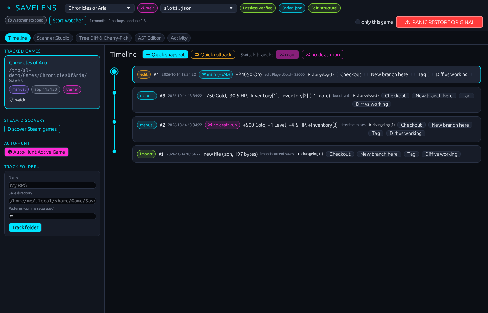
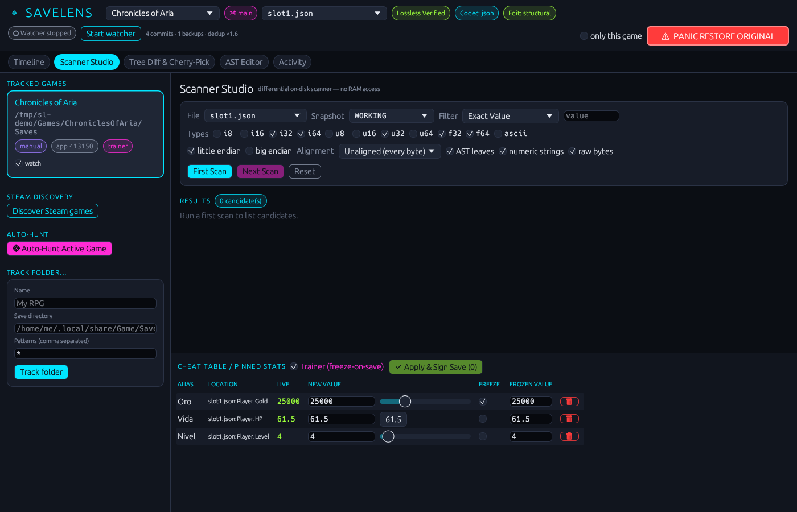
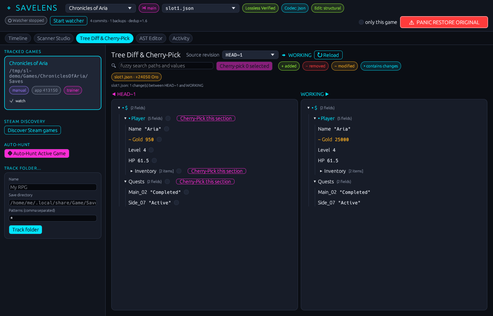
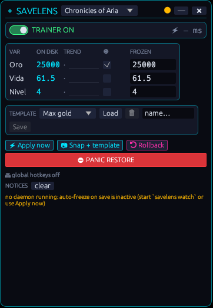
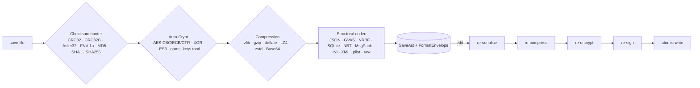

<div align="center">

# 🔍 SaveLens

**Semantic version control, an on-disk "Cheat Engine" and live branches for video-game saves.**

Linux (native + Steam Proton/Wine) · Windows · 100% Rust · No Git underneath · Zero-corruption by design

[](https://github.com/gabildev/savelens/actions/workflows/ci.yml)


</div>

---

SaveLens watches your games' save folders, snapshots every save into its own deduplicated
content-addressable store, and understands what changed:

```text
#41  2026-10-14 21:03:12  auto        game saved — +500 Gold, +1 Level, Main_02 → "Completed"
#40  2026-10-14 20:51:40  trainer     freeze-on-save: Oro
#39  2026-10-14 20:51:39  auto        game saved — -1200 Oro, Inventory[3] → "Iron Sword"
```

It finds variables across snapshots like Cheat Engine does in RAM — but on disk, through
encryption, compression and checksums — lets you alias, freeze and edit them, and restores
any sub-tree of an old save (`Player.Inventory`) into your current progress.

<p align="center">
  
  
</p>
<p align="center">
  
  
</p>

## Table of contents

- [Why](#why)
- [Features](#features)
- [Zero-corruption guarantee](#zero-corruption-guarantee)
- [Install](#install)
- [Quick start](#quick-start)
- [The pipeline](#the-pipeline)
- [Supported formats](#supported-formats)
- [CLI reference](#cli-reference)
- [TUI, GUI and overlay](#tui-gui-and-overlay)
- [Encryption profiles (`game_keys.toml`)](#encryption-profiles-game_keystoml)
- [Configuration](#configuration)
- [Architecture](#architecture)
- [Development](#development)

## Why

Backup tools copy folders. SaveLens *reads* your saves:

| Problem | Ludusavi / SaveState | SaveLens |
|---|---|---|
| Find saves without configuration | Path database | Steam/Proton/Flatpak discovery **+ engine heuristics + live process hunter** |
| Know what changed between saves | ✗ | Semantic changelog (`Player.Gold: 1200 -> 1500 (+300)`) |
| Find "where is my gold stored?" | ✗ | Multi-snapshot scanner over AST paths and raw offsets |
| Edit encrypted / compressed / signed saves | ✗ | Transparent decrypt → decompress → strip checksum → edit → re-sign |
| Restore only part of an old save | ✗ | Surgical cherry-pick of sub-trees |
| Branch a playthrough | Manual folders | Branches, tags, checkout, quick rollback |
| Never corrupt a save | — | Round-trip gate, verified shadow backups, atomic writes, panic restore |

## Features

- **Zero-config auto-discovery** — parses `libraryfolders.vdf` / `appmanifest_*.acf` (native, Flatpak, Snap,
  Windows registry), maps Proton prefixes (`compatdata/<AppID>/pfx/drive_c/users/steamuser/…`), applies a
  Ludusavi-style rule database and engine heuristics (Unity `app.info`, Unreal `Saved/SaveGames`, Godot,
  Ren'Py, GameMaker, RPG Maker, Source).
- **Live Process Hunter** — inspects running game processes (`/proc/<pid>/fd` + `fdinfo` write flags,
  `inotify`; `ReadDirectoryChangesW` on Windows) to catch the file a game is saving right now.
- **Lossless multi-layer pipeline** — `Decrypt → Strip checksum → Decompress/Base64 → Parse AST`, every layer
  reversible and verified bit-for-bit.
- **Merkle-hashed `SaveAst`** (`blake3`) — diffing a 200 000-leaf tree with one change skips every identical
  sub-tree.
- **Save-State Scanner** — `First Scan` / `Next Scan` with exact, `Increased by`, `Decreased by`, `Increased`,
  `Decreased`, `Changed`, `Unchanged`, ranges and `A -> B` transitions over AST leaves, numeric strings and raw
  bytes (`i8…u64`, `f32`, `f64`, ASCII decimals; LE/BE; aligned or not; unknown-initial-value snapshots with a
  dirty-byte bitmap).
- **Cheat table** — aliases (`"Oro"`, `"HP"`), live values, edit & re-sign, **freeze on save**.
- **Disk trainer** — when the game autosaves, frozen values are injected atomically and re-signed
  (typically a few milliseconds; the latency is reported and checked against a 50 ms budget).
- **Surgical cherry-pick** — copy `Player.Inventory` from last week's save into today's without losing progress.
- **Own CAS** (no Git, nothing inside the game folder) — FastCDC chunking + zstd + SQLite commit graph,
  branches, tags, semantic changelogs, cheat tables and safety backups.
- **Four front-ends on one engine** — CLI, `ratatui` TUI, `egui` desktop GUI and a translucent always-on-top
  **mod-menu overlay**, plus a background daemon with **global hotkeys**.

## Zero-corruption guarantee

These invariants are enforced in code and covered by tests:

1. **Total isolation of the game directory.** No `.savelens` folders, no `.bak`, no temp files next to your
   saves. Writes are staged in SaveLens' data directory and moved with `rename(2)`; if the save folder is on
   another filesystem the file is overwritten in place and verified. Tests assert the directory listing never
   changes.
2. **Debounce & lock check.** The watcher waits for `IN_CLOSE_WRITE` / quiet time, checks size+mtime
   stability and refuses to read while any process holds the file open for writing (`/proc/*/fdinfo` on Linux,
   exclusive share-mode open on Windows).
3. **Immutable pre-mutation shadow backup.** Before any write (edit, checkout, cherry-pick, trainer, restore)
   the current bytes are stored under `safety/pre-mutation-<timestamp>`, re-read from the CAS and verified with
   `blake3`. If that fails, nothing is written.
4. **Safe Edit Gate.** Every file is opened with `serialize(deserialize(bytes)) == bytes`. If one bit differs,
   only raw in-place edits (with checksum/compression/encryption recomputed) or full backup/restore are allowed.
5. **Panic Restore.** `savelens panic-restore`, the red button in GUI/TUI/overlay and `Ctrl+Shift+F12` revert
   the last touched file to its pre-mutation bytes and verify the hash. Pressing it again walks further back.

## Install

```bash
git clone https://github.com/gabildev/savelens
cd savelens
cargo install --path crates/savelens-cli          # `savelens` with CLI + TUI + GUI + overlay
# headless servers / minimal build:
cargo install --path crates/savelens-cli --no-default-features
```

Linux GUI/overlay builds need the usual X11/Wayland development packages at runtime
(`libxkbcommon`, `libwayland`, `libGL`). Global hotkeys use X11 on Linux and `RegisterHotKey` on Windows.

## Quick start

```bash
savelens discover                       # find Steam games and their save folders
savelens discover --track-all           # …and start tracking all of them
savelens track "Hero Quest" ~/.config/unity3d/Studio/HeroQuest -p '*.json'

savelens watch                          # daemon: auto-commit every save, hotkeys on
savelens log "hero" --full              # semantic history

# Find the gold variable: it was 1500 two saves ago and 1300 now.
savelens scan hero slot1.json HEAD~1=1500 HEAD=1500->1300 --pin Oro
savelens set hero Oro 99999             # decrypt → edit → re-encrypt → re-sign → atomic write
savelens freeze hero Oro 99999 && savelens trainer hero on   # freeze on every autosave

savelens cherry-pick hero HEAD~5 slot1.json Player.Inventory
savelens panic-restore                  # oops: back to the exact previous bytes
```

## The pipeline



Layers are peeled iteratively (up to 8 deep) and re-applied in reverse. Each layer records the exact
parameters it found (IV, compression level, gzip header, size prefix, checksum position/encoding) and reports
whether re-encoding modified data is bit-exact with the original encoder (e.g. zlib via `zlib-rs`).
The integrity bar summarises it: `Lossless Verified · Checksum Auto-Matched: CRC32 · Compression: Zlib level 6`.

## Supported formats

| Codec | Id | Detection | Edits | Notes |
|---|---|---|---|---|
| JSON | `json` | `{`/`[` + full parse | values + structure | Byte-exact CST (whitespace, number spelling, escapes, BOM, trailing bytes). **Recursive nested JSON**: JSON-in-strings, Base64 JSON and Base64+zlib/gzip JSON are expanded and re-escaped. |
| Unreal GVAS | `gvas` | `GVAS` magic | values, array/set lengths | UE4 / UE5 incl. 5.4 tags; Int/UInt/Float/Double/Str/Name/Bool/Byte/Enum/Struct(GUID)/Array/Map/Set/Object/SoftObject; unknown types kept as raw bytes. |
| .NET BinaryFormatter | `nrbf` | stream header | values, strings | All records 0–17; object graph projected from the root; shared strings tracked. |
| Unity PlayerPrefs | `playerprefs` | `<unity_prefs>` | values | Base64 strings decoded/re-encoded. |
| SQLite | `sqlite` | `SQLite format 3` | UPDATE / INSERT / DELETE | `Table → PK → Column`, schema never altered, WAL checkpointed. |
| NBT | `nbt` | root compound | values + structure | Java (BE, MUTF-8) and Bedrock (LE + `level.dat` header); gzip via the pipeline. |
| MessagePack | `msgpack` | full parse | values + structure | Original markers preserved (non-minimal encodings survive). |
| INI / CFG | `ini` | line heuristics | values + structure | Comments, quotes, delimiters, line endings preserved. |
| XML | `xml` | well-formed | values | Lossless tokenizer, entities, CDATA. |
| XML plist | `plist` | `<plist>` | values | dict/array/integer/real/string/bool/date/data. |
| Raw binary | `raw` | fallback | in-place | String index, block hashes; the scanner edits primitives at offsets. |

## CLI reference

```text
savelens tui | gui | overlay [--game G] [--opacity 0.88] [--no-daemon] [--no-hotkeys]
savelens watch [--game G]… [--no-hotkeys]
savelens discover [--track-all]            savelens hunt [--seconds 30] [--pid P] [--root DIR]…
savelens track NAME DIR [-p GLOB]… [--app-id ID]      savelens untrack G      savelens games
savelens status [G]                        savelens snapshot G [-m MSG]
savelens log G [--branch B] [-n N] [--full]          savelens diff G [FROM] [TO] [--file F]
savelens inspect PATH [--depth N]          savelens get G FILE [PATH] [--rev R]
savelens edit G FILE TARGET VALUE [--raw]  (TARGET = Player.Gold or $@0x1a4:i32le)
savelens scan G FILE REV=FILTER… [--types i32,f32,…] [--endian le|be|both] [--align …] [--raw] [--pin ALIAS]
savelens pin G FILE ALIAS LOCATION         savelens cheats G      savelens set G ALIAS VALUE
savelens freeze G ALIAS [VALUE] [--off]    savelens trainer G on|off [--apply]
savelens cherry-pick G REV FILE PATH… [--merge] [--strict]
savelens checkout G REV [--file F]…        savelens rollback G
savelens branch G [NAME] [--from REV] [--switch] [--delete]   savelens switch G BRANCH   savelens tag G [NAME] [REV]
savelens panic-restore [--game G] [--via-daemon]     savelens backups [--game G]     savelens restore-backup TAG
savelens gc | verify | config [--init] | keys | codecs
```

Revisions: `HEAD`, `HEAD~N`, `<branch>`, `<branch>~N`, `<tag>`, `#<id>` or a numeric id; `WORKING` is the
file on disk. Scanner filters: `1500`, `=1500`, `1500->1300`, `+300`, `-=300`, `inc`, `dec`, `changed`,
`unchanged`, `10..20`, `?` (unknown initial value). Add `--json` to most commands for machine output.

## TUI, GUI and overlay

- **TUI** (`savelens tui`, Vim keys, `?` for help): *Games & Watcher*, *Timeline & Branches*,
  *Scanner (Cheat Engine mode)*, *AST Explorer & Cherry-Pick*. `P` = Panic Restore.
- **GUI** (`savelens gui`): dark neon theme, sidebar with discovered games and **Auto-Hunt Active Game**,
  commit graph with semantic cards, **Scanner Studio** with the **Cheat Table / Pinned Stats** panel and
  **Apply & Sign Save**, side-by-side **Visual Tree Diff** with *Cherry-Pick this section*, integrity bar and a
  red **Panic Restore Original** button.
- **Overlay** (`savelens overlay`): translucent, borderless, always-on-top mod menu for borderless-fullscreen
  games — live pinned stats, freeze toggles, trainer master switch, presets, injection latency.

Default global hotkeys (configurable in `config.toml`):

| Hotkey | Action |
|---|---|
| `Ctrl+Shift+F5` | Quick snapshot |
| `Ctrl+Shift+F9` | Quick rollback (previous commit) |
| `Ctrl+Shift+F10` | Toggle disk trainer |
| `Ctrl+Shift+F11` | Show / hide overlay |
| `Ctrl+Shift+F12` | **Panic Restore** |

## Encryption profiles (`game_keys.toml`)

The built-in database knows Unity Easy Save 3's stock password and community-documented game profiles.
Add your own in `~/.config/savelens/game_keys.toml` (or `%APPDATA%\savelens\game_keys.toml`,
`$SAVELENS_HOME/game_keys.toml`, `$SAVELENS_KEYS`). The repository's [`game_keys.toml`](game_keys.toml)
documents every field with examples (AES-CBC/ECB/CTR, XOR, rolling XOR, ES3). Single-byte XOR is
brute-forced automatically; high entropy files are flagged with their Shannon entropy.

## Configuration

Everything lives in `$SAVELENS_HOME` or the platform data directory
(`~/.local/share/savelens`, `%LOCALAPPDATA%\savelens`):

```text
savelens/
├── savelens.db        SQLite: games, commits, branches, tags, changelogs, cheat table, safety backups, events
├── chunks/ab/…zst     FastCDC chunks, zstd-compressed, blake3-addressed
├── staging/           atomic-write staging area (always empty at rest)
└── config.toml        debounce, lock timeout, hotkeys, limits (`savelens config --init`)
```

## Architecture

```text
crates/
├── savelens-core        SaveAst, NodePath, Merkle (blake3), semantic diff, scanner, cherry-pick — no I/O
├── savelens-codecs      EnvelopePipeline: crypto · checksum · compression · 11 structural codecs
├── savelens-cas         FastCDC + zstd chunk store, SQLite graph, safety protocol, panic restore
├── savelens-discovery   Steam/Proton/Flatpak, rules DB, engine heuristics, process hunter, lock check
├── savelens-watcher     Engine facade, daemon (debounce, lock check, auto-commit, trainer), hotkeys
├── savelens-tui         ratatui + crossterm
├── savelens-gui         eframe / egui
├── savelens-overlay     eframe transparent always-on-top mod menu
└── savelens-cli         `savelens` binary (clap)
```

SQLite (WAL) doubles as the IPC bus: the daemon, the overlay, the GUI and the CLI share state and queue
requests (`panic-restore`, `snapshot`, `toggle-overlay`) through the store.

## Development

```bash
cargo test --workspace
cargo clippy --workspace --all-targets -- -D warnings
cargo fmt --all
SAVELENS_HOME=/tmp/sl cargo run -p savelens-cli -- --help
```

The test-suite builds real fixtures with independent writers and asserts bit-exact round trips for every
codec and layer, edit + re-sign/re-compress flows, game-directory isolation and panic restore on real
temporary directories. See [`CLAUDE.md`](CLAUDE.md) for the engineering rules.

## License

Dual-licensed under MIT or Apache-2.0, at your option.
